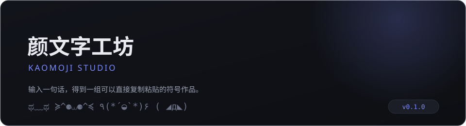
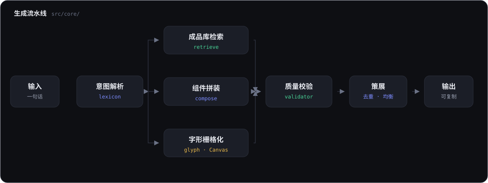

# 颜文字工坊 · Kaomoji Studio

[](./package.json)
[](./LICENSE)
[](https://react.dev)
[](https://www.typescriptlang.org)
[](https://vitejs.dev)
[](https://nodejs.org)



输入一句话，得到一组**可以直接复制粘贴**的符号作品（颜文字 / 组合颜文字 / 拼字 / 图案）。

- 仓库：<https://cnb.cool/lpk3215/yanwenzi>
- 在线演示：<!-- TODO: 在线演示链接待补充 -->

## 核心设计

四层作品，三条生成策略：

| 层级 | 形态 | 生成方式 |
|---|---|---|
| L1 单行颜文字 | `ಥ﹏ಥ` | 成品库检索 |
| L2 组合颜文字 | `٩(*´◒`*)۶` | 组件拼装（语法 + 约束） |
| L3 拼字 | 用符号拼出 `喜` | 字形栅格化（Canvas） |
| L4 图案 | 多行大图 | 成品库 |

> 词库规模：成品库 **167** 条（含 4 条多行图案）；组件库 **146** 个零件（眼 56 / 嘴 39 / 臂 17 / 腮红 14 / 装饰 20）。

**AI 的定位：调度员，不是渲染器。**
模型只把自然语言翻译成结构化意图（JSON），颜文字本身永远由确定性工具产出。
这样输出可校验、可复现、可回退。

**零模型可用。** AI 是可选开关，默认关闭。

## 架构



模型只出现在「意图解析」这一步，且是可选的；其余环节全是确定性工具。

## 技术栈

| 类别 | 选型 | 版本 |
|---|---|---|
| UI | React | ^18.3.1 |
| 语言 | TypeScript | ^5.6.3 |
| 构建 | Vite | ^5.4.11 |
| 运行时 | Node.js | >= 18 |
| 运行时依赖 | 仅 `react` / `react-dom` | — |

> 除 React 外没有第三方运行时依赖：显示宽度计算、字形栅格化、组件拼装、校验器均为手写实现。

## 快速开始

```bash
npm install
npm run dev      # http://localhost:5173
```

构建：

```bash
npm run build    # 产出静态文件到 dist/
npm run preview
```

重新生成文档配图（脚本产物在 `docs/`）：

```bash
node scripts/visualization/generate_banner.mjs
node scripts/visualization/generate_architecture.mjs
```

## 目录结构

```
src/
  core/
    width.ts       显示宽度计算（EAW + 组合字符 + VS16）—— 地基
    lexicon.ts     同义词归一 → 结构化意图（规则版）
    validator.ts   质量闸门：宽度 / 括号 / 行数 / 字符安全
    retrieve.ts    策略一：成品库检索打分
    compose.ts     策略二：组件拼装（语法 + 约束 + 去重）
    glyph.ts       策略三：字形栅格化（Canvas，覆盖率映射 + 半格块）
    ai.ts          可选的 AI 意图解析
    pipeline.ts    编排：意图 → 分发 → 生成 → 校验 → 策展
  data/
    kaomoji.ts     成品库
    parts.ts       组件库（眼 / 嘴 / 臂 / 腮红 / 装饰 / 括号）
  App.tsx          界面
  main.tsx         入口
  styles.css       样式
index.html         页面模板
vite.config.ts     构建配置
tsconfig.json      TypeScript 配置
package.json       依赖与脚本
LICENSE            许可证（MIT）
README.md          项目说明
CONTRIBUTING.md    贡献指南
CHANGELOG.md       变更日志
FAQ.md             常见问题
AUTHORS            贡献者
.editorconfig      编辑器约定
.gitattributes     行尾与语言统计规范
docs/
  banner.svg       README 横幅（脚本生成）
  architecture.svg 架构图（脚本生成）
scripts/
  visualization/
    generate_banner.mjs        生成 docs/banner.svg
    generate_architecture.mjs  生成 docs/architecture.svg
```

## 为什么不用 `str.length`

`(˘̩̩̩ε˘̩ƪ)` 里的 `̩` 是组合字符（0 列），`好` 是 2 列，`⚈` 是 1 列。
所有排版都走 `displayWidth()`，否则一歪就是歪一片。

## 字形栅格化的两个坑

**坑一：均值映射会把细笔画吃掉。**
一格里只有 30% 面积是笔画时，平均亮度会掉到接近空白那一档。改用**覆盖率**（亮度超过阈值的像素占比）配 gamma 提升对比度，笔画才能立起来。

**坑二：字符格的宽高比是 1:2，纵向分辨率天然只有横向的一半。**
「喜」有七道横画，25 行的网格根本分不开。解法是半格块 `▀▄█` —— 一个字符格编码上下两个像素，纵向分辨率直接翻倍。

代价：`▀▄█` 的 East Asian Width 是 **Ambiguous**，部分中文环境下会被按 2 列渲染，整幅画横向拉伸。
所以默认输出走 `symbol` 风格（纯窄字符，宽度绝对安全），`block` 风格作为可选，并会在卡片上标注风险。

## Roadmap

- [x] MVP：成品库 + 组件拼装 + 宽度计算 + 校验器 + 字形栅格化
- [x] 组件库扩容、成品库扩容

## 更新日志

见 [CHANGELOG.md](./CHANGELOG.md)。

## 贡献

欢迎提 Issue / PR，流程见 [CONTRIBUTING.md](./CONTRIBUTING.md)；
常见问题先看 [FAQ.md](./FAQ.md)。

## 作者

- cnb.lpk

仓库：<https://cnb.cool/lpk3215/yanwenzi>

## 许可证

[MIT](./LICENSE)
